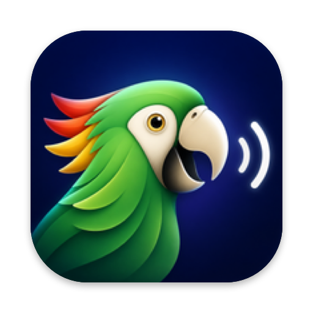

<div align="center">



# Parrot

**Select any text on your Mac, press ⌥Esc, and hear it read aloud in a natural voice, fully offline.**

[](#requirements)
[](#requirements)
[](Parrot.swift)
[](speakd.py)
[](https://github.com/hexgrad/kokoro)
[](#privacy)
[](LICENSE)

</div>

---

Parrot is a tiny menu-bar app that reads your selected text with [Kokoro](https://github.com/hexgrad/kokoro), an open-weight text-to-speech model that sounds far more human than the built-in macOS voices. Everything runs on your Mac: no account, no API key, no cloud.

## Features

- 🦜 **Works in any app.** Reads the selection directly through macOS Accessibility, falling back to a copy that restores your clipboard.
- ⚡ **Starts almost instantly.** The model stays loaded, and speech begins after the first sentence while the rest is generated.
- 🎛️ **Full playback control.** Pause, resume, skip a sentence or stop, from hotkeys or the menu-bar popover.
- 🧠 **Choose your model.** The fast model is built in; download Balanced (169 MB) or Best (310 MB) quality from Settings with one click.
- 🗣️ **28 English voices.** American and British, female and male, each previewed when you pick it.
- 🐇 **Adjustable speed** from 0.8× to 2.5×, applied from the next sentence.
- 🔗 **Launcher-friendly.** A `parrot://` URL scheme, with ready-made [Tinycast](https://github.com/douo/tinycast) commands.
- 🔒 **Private.** Text never leaves your machine.

## Install

```sh
git clone https://github.com/brahimhamichan/parrot.git
cd parrot
./install.sh
```

The installer:

1. Checks for the Xcode Command Line Tools and starts their install if needed.
2. Installs [uv](https://github.com/astral-sh/uv) if missing and creates a private Python 3.12 environment in `~/Library/Application Support/Parrot/venv`.
3. Builds `~/Applications/Parrot.app` with the voice model bundled inside. On first launch it adds itself to Login Items (toggle in Settings).
4. Adds Parrot commands to Tinycast, if Tinycast is installed.

Then allow **Parrot** in **System Settings → Privacy & Security → Accessibility**. That's the only manual step; macOS requires it so Parrot can read selected text.

The first install downloads about 100 MB of Python packages. After that Parrot works without internet.

## Usage

| Action | Shortcut |
|---|---|
| Read the selection, or stop if already speaking | **⌥ Esc** |
| Pause or resume | **⌥ ⇧ Esc** |
| Stop (only active while speaking) | **Esc** |

Click the menu-bar icon for the popover: **Read Selection**, playback controls while speaking, a searchable **voice** picker with previews, and a **speed** slider. The gear opens **Settings**: model downloads, launch at login, Accessibility status and shortcuts. The icon fills in while speaking and shows a pause symbol when paused. Everything is remembered.

| Model | Size | Notes |
|---|---|---|
| Fast | 88 MB | Built in (int8). Quickest start. |
| Balanced | 169 MB | Download in Settings (fp16). Slightly cleaner audio. |
| Best | 310 MB | Download in Settings (fp32). Richest sound, slower start. |

Downloaded models are stored in `~/Library/Application Support/Parrot/models`.

### URL scheme

Use these from any launcher, script or Shortcut (`open -g` keeps your current app focused):

```sh
open -g parrot://speak          # read selection / stop
open -g parrot://open           # show the popover (parrot://settings opens Settings)
open -g parrot://pause          # pause / resume
open -g parrot://stop
open -g parrot://skip
open -g parrot://faster         # or parrot://slower
open -g "parrot://speed?1.5"
open -g "parrot://voice?bm_george"
```

### Tinycast

`./install.sh` adds **Parrot: Read Selection**, **Pause / Resume**, **Stop**, **Skip Sentence**, **Faster**, **Slower** and **Settings** to Tinycast's Custom Commands, keeping your existing commands. Run `python3 tinycast-commands.py` to re-add them. Give **Parrot: Read Selection** a global shortcut in Tinycast → Settings → Shortcuts; running it from the open palette may find no selection, because the palette has focus.

## How it works

```
 ⌥Esc ──▶ Parrot.app (Swift, menu bar)
            │  reads the selection via Accessibility (AXSelectedText)
            ▼
          speakd.py on 127.0.0.1:47811
            │  splits into sentences → Kokoro (ONNX, int8) → audio stream
            ▼
          your speakers 🔊
```

- **`Parrot.swift`**: app state, global hotkeys, selection reading, model downloads and URL scheme. It starts the daemon and restarts it if it exits.
- **`PopoverView.swift`**: the SwiftUI popover (player, voice picker, speed, settings).
- **`speakd.py`**: local HTTP daemon that keeps Kokoro loaded and streams audio through one output stream, which is what makes pause and skip instant.
- **`models/`**: Kokoro v1.0 int8 weights and voices (about 120 MB), bundled into the app at build time.
- **`assets/icon-source.png`**: the app icon artwork; `tools/makeicon.swift` fits it to the macOS icon shape and `build.sh` builds the `.icns`.

## Requirements

- macOS 14 Sonoma or later (developed on Apple Silicon)
- Xcode Command Line Tools (the installer prompts for them)
- About 400 MB of disk space and about 320 MB of RAM while running

## Privacy

Parrot makes no network requests, except downloading a model from the [kokoro-onnx releases](https://github.com/thewh1teagle/kokoro-onnx/releases/tag/model-files-v1.0) when you click Download. The daemon only listens on `127.0.0.1`. Selected text goes to the local model and is never stored. A small diagnostic log (no text content) is written to `~/Library/Logs/Parrot.log`.

## Troubleshooting

| Problem | Fix |
|---|---|
| It beeps and doesn't speak | Grant Accessibility access (see Install). If the log shows `trusted=0`, remove Parrot from the Accessibility list and add it again. |
| ⌥Esc does nothing | Turn off macOS's own **Speak selection** (Accessibility → Spoken Content), which uses the same shortcut. |
| No menu-bar icon | It may be hidden behind the notch. Run `open parrot://open` (or the Tinycast **Parrot: Settings** command); the popover then opens at the top of the screen. |
| Speech never starts | Check `~/Library/Logs/Parrot.log`, and run `./install.sh` again to rebuild the Python environment. |

## Uninstall

```sh
osascript -e 'tell application id "dev.brahim.parrot" to quit'
rm -rf ~/Applications/Parrot.app "$HOME/Library/Application Support/Parrot" ~/Library/Logs/Parrot.log
defaults delete dev.brahim.parrot
```

Also remove Parrot from Login Items and from the Accessibility list in System Settings.

## Contributing

Issues and pull requests are welcome; see [CONTRIBUTING.md](CONTRIBUTING.md).

## Credits

- [Kokoro](https://github.com/hexgrad/kokoro) by hexgrad, the voice model (Apache-2.0)
- [kokoro-onnx](https://github.com/thewh1teagle/kokoro-onnx) by thewh1teagle, the ONNX runtime wrapper and model files (MIT)

See [NOTICE.md](NOTICE.md) for all third-party licenses.

## License

[MIT](LICENSE) © 2026 Brahim Hamichan
